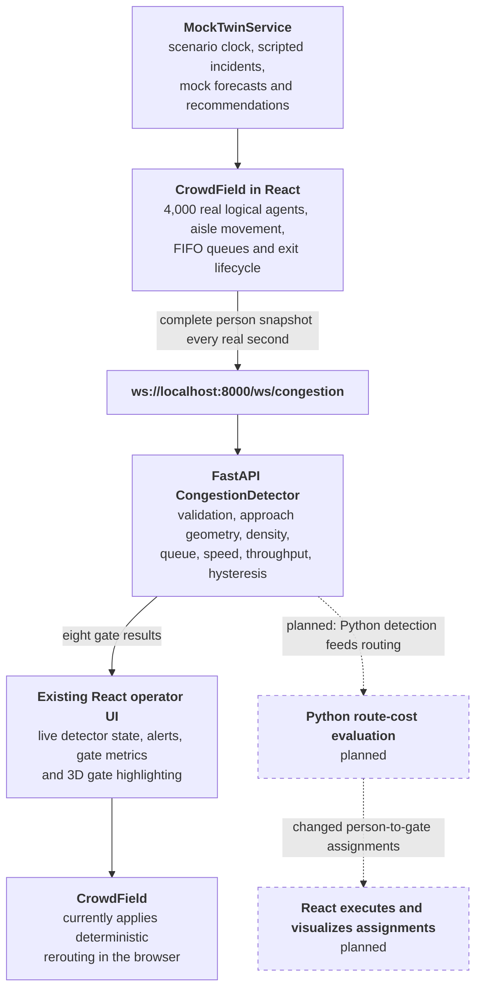

# North Star

**Spot the jam at Gate B before the crowd feels it, and send people somewhere better.**

The match ends. 4,000 people stand up at once and head for eight exits. One gate closes, another starts backing up, and an operator has a few seconds to decide what to do.

North Star is a human-in-the-loop stadium crowd-management prototype built around that moment. The current application simulates exactly 4,000 people leaving a fictional stadium through eight controllable exits, streams every person's state to Python, detects persistent gate congestion, and reroutes affected people using an explainable deterministic cost function.

> [!WARNING]
> The project is intentionally a decision-support demonstrator. It is not certified evacuation software and must not be presented as guaranteed public-safety guidance.

## 📍 At a glance

| | |
| --- | --- |
| **Population** | Exactly 4,000 stable logical person identities per simulation run |
| **Exits** | Eight controllable gates, Gate A through Gate H |
| **Seating** | Twenty-four seating sections |
| **Telemetry** | Complete per-person snapshot from React to FastAPI once per real second |
| **Detection** | Python-owned gate density, queue, speed, throughput, persistence, and clearing |
| **Rerouting** | Deterministic and explainable; currently applied in the browser |
| **Forecasts and interventions** | Mock or formula-driven in the default 3D experience |
| **Status** | Hybrid prototype: movement and congestion are integrated; forecasting and intervention planning are only partially connected |

## Contents

- [📍 At a glance](#-at-a-glance)
- [🧱 Current status](#-current-status)
- [🧭 System architecture](#-system-architecture)
- [👥 Stadium and person model](#-stadium-and-person-model)
- [🚦 Congestion detection](#-congestion-detection)
- [🔀 Current rerouting logic](#-current-rerouting-logic)
- [📡 Telemetry contract](#-telemetry-contract)
- [💻 Application modes](#-application-modes)
- [📁 Repository layout](#-repository-layout)
- [🚀 Getting started](#-getting-started)
- [🎬 Running the demo](#-running-the-demo)
- [🔌 Backend interfaces](#-backend-interfaces)
- [📈 Deterministic forecast baseline](#-deterministic-forecast-baseline)
- [🧪 Tests and quality checks](#-tests-and-quality-checks)
- [🐳 Docker](#-docker)
- [📌 Immediate roadmap](#-immediate-roadmap)
- [🔒 Safety and privacy](#-safety-and-privacy)

## 🧱 Current status

The repository is a hybrid prototype: the movement and congestion path is integrated, while forecasting and intervention planning are only partially connected.

| Area | State | Where |
| --- | --- | --- |
| 4,000-person movement, gate queues, operator gate control | ✅ Implemented and connected | React `CrowdField` |
| Live per-gate congestion detection | ✅ Implemented and connected | FastAPI `CongestionDetector` over `/ws/congestion` |
| Deterministic rerouting | ✅ Implemented and connected, browser-owned | React `CrowdField` |
| Mass-balance forecast baseline | 🟡 Real algorithm, not connected to the 3D stream | `backend/app/forecasting/baseline.py` |
| Synthetic zone-level simulation | 🟡 Real, exposed over REST only | `backend/app/simulation/` |
| Scenario clock, forecasts, interventions in the 3D page | ⚪ Mocked | `MockTwinService`, `MockScenarioEngine` |
| Python `ResponseService` | ⚪ Formula-based placeholder | `backend/app/response/` |
| Python-owned routing, live forecasts, dataset, ML, rollouts | ⏳ Pending | See below and the roadmap |

### Implemented and connected

- Existing 3D React stadium design rendered with React Three Fiber and Three.js.
- Exactly 4,000 stable logical person identities per simulation run.
- Twenty-four seating sections and eight exits, Gate A through Gate H.
- Explicit movement through the seat row, section aisle, lower base path, gate corridor, FIFO queue, and exterior exit path.
- Capacity-limited queues at every gate.
- Individual operator control to open or close any gate.
- Permanent removal after a person exits; an exited ID cannot reappear during the run.
- Complete per-person telemetry sent from React to FastAPI once per real second.
- Backend validation of population accounting, unique IDs, run IDs, and increasing sequence numbers.
- Python-owned gate density, queue, speed, throughput, persistence, and clearing calculations.
- Live congestion presentation in the existing incident strip, risk summary, gate list, header, and 3D gate treatment.
- Automatic WebSocket reconnect and an explicit detector-unavailable state.
- Deterministic rerouting away from closed or backend-confirmed congested gates.
- Shared stadium geometry consumed by both TypeScript and Python.
- Unit, API, browser, build, lint, and Docker Compose checks.

### Real algorithms that are not connected to the 3D stream yet

- The backend contains an explainable mass-balance forecast baseline in `backend/app/forecasting/baseline.py`.
- The backend exposes REST endpoints for a separate synthetic zone-level simulation.
- Those REST forecasts operate on the synthetic backend snapshot, not on the default 3D application's per-person telemetry.

### Still mocked or formula-driven

The default 3D page uses `MockTwinService` and `MockScenarioEngine` for:

- scenario clock and scripted stage progression;
- Gate B and metro-delay narrative timing;
- zone density curves shown outside the live gate detector result;
- 5- and 10-minute forecast curves and confidence values;
- contributing-factor percentages;
- intervention candidates and predicted outcomes;
- recommendation timing, ranking, approval narrative, and stabilization stage.

The Python `ResponseService` is also a deterministic formula-based placeholder. It returns predefined candidate shapes with calculated multipliers; it does not clone the 4,000-person simulation or run real counterfactual rollouts.

### Pending

- Move the person-to-gate routing decision from React into Python.
- Aggregate the live person stream into rolling zone histories.
- Generate the first reproducible multi-run stadium dataset.
- Connect the deterministic 5- and 10-minute forecast baseline to the live 3D run.
- Train gradient-boosted forecasting models only after the dataset exists.
- Replace formula-based intervention outcomes with actual simulation rollouts.
- Return backend routing assignments and intervention decisions to the frontend.
- Add measured before/after evaluation for queue, density, clearance time, walking distance, and rerouting.
- Calibrate capacities and thresholds against documented assumptions.
- Defer the wildfire scenario until the stadium loop is complete.

See [PROJECT_CONTEXT.md](PROJECT_CONTEXT.md) for the canonical architecture, ordered TODO, ownership, and acceptance criteria.

## 🧭 System architecture

The default application at `/` follows the solid path below. Dashed edges show the intended next architecture, which moves the final decision boundary into Python.



Planned flow, step by step:

```text
React movement telemetry
    -> Python detection
    -> Python route-cost evaluation
    -> changed person-to-gate assignments
    -> React executes and visualizes assignments
```

No ML model is required for gate reassignment. The routing cost can remain deterministic and explainable. ML is reserved for future congestion forecasting after a suitable simulation dataset exists.

## 👥 Stadium and person model

The shared configuration is [shared/stadium-config.json](shared/stadium-config.json). It defines:

- population and coordinate scale;
- stadium bowl and circulation-ring geometry;
- Gate A to H identifiers, labels, and angles;
- default gate capacity;
- gate-approach geometry used by the Python detector.

The current prototype capacity is 90 people per simulated minute at each open gate. This is configurable demonstration data, not a measured stadium capacity.

Each person moves through these states:

```text
waiting in seat
    -> moving along row
    -> descending section aisle
    -> moving around lower base path
    -> moving through selected gate corridor
    -> waiting in FIFO gate queue
    -> crossing exit
    -> exited and removed
```

Movement is a deterministic waypoint model. It does not currently implement physical person-to-person collision forces. This keeps the first milestone reproducible and makes queue and route behavior easier to test.

## 🚦 Congestion detection

The backend constructs all eight approach polygons from the shared stadium configuration. For every telemetry batch it calculates:

- number of people inside the gate approach;
- approach density in people per square metre;
- queue length for people assigned to that gate and below the queue-speed threshold;
- mean walking speed;
- exits recorded during the trailing simulated minute;
- raw risk level;
- persistent congestion and clearing state.

Current prototype defaults:

| Signal | Elevated | High | Critical |
| --- | --- | --- | --- |
| Approach density | 2.2 people/m² | 3.2 people/m² | 4.5 people/m² |
| Queue length | 40 people | 80 people | 160 people |

| Setting | Value |
| --- | --- |
| Queue-speed threshold | 0.6 m/s |
| Critical-speed threshold | 0.35 m/s |
| Congestion persistence | 5 simulated seconds |
| Clear persistence | 10 simulated seconds |

> [!IMPORTANT]
> These thresholds are engineering defaults for the prototype. They are not certified crowd-safety limits.

## 🔀 Current rerouting logic

A person becomes eligible for reassignment when the assigned gate is closed or Python confirms persistent congestion at that gate.

Closed gates are excluded. Remaining gates are scored using:

```text
walking-distance cost
  + queue-length penalty
  + approach-density penalty
  + confirmed-congestion penalty
  + deterministic tie breaker
```

A switching margin and cooldown reduce oscillation. The next milestone will move this scoring into Python and return only changed assignments to React.

## 📡 Telemetry contract

The frontend sends `message_type: "telemetry"` over `/ws/congestion` once per real second.

Every batch contains:

| Field | Meaning and validation |
| --- | --- |
| `run_id` | Stable for one simulation epoch |
| `sequence` | Strictly increasing within the run |
| `simulation_time_seconds` | Simulated, not wall-clock, time |
| `population` | Must equal 4,000 |
| `agents` | Every currently active identity |
| `exited_agents` | Every identity already removed from the run |

An active person contains:

```json
{
  "person_id": 1842,
  "x": 12.4,
  "z": 5.4,
  "speed_mps": 0.3,
  "target_gate": "gate_b",
  "movement_state": "queued"
}
```

An exited person contains:

```json
{
  "person_id": 1842,
  "target_gate": "gate_b",
  "exited_at_seconds": 327.4
}
```

The backend returns one congestion record for each of the eight gates. Protocol validation errors are returned as structured WebSocket error messages without terminating the connection.

## 💻 Application modes

| Mode | URL | What it shows |
| --- | --- | --- |
| **Default 3D stadium** | `http://localhost:5173/` | The main experience. It contains the 4,000-person frontend simulation and the live `/ws/congestion` integration. |
| **Legacy REST dashboard** | `http://localhost:5173/?mode=live` | The separate Python `CrowdSimulation` zone model through REST. |

> [!NOTE]
> Despite the historical query name, `?mode=live` is not the live 3D person stream. It is useful for exercising the baseline forecast and response API contracts, but it should not be used to claim end-to-end 3D forecast integration.

## 📁 Repository layout

```text
North Star/
├── backend/
│   ├── app/
│   │   ├── congestion/       # Live per-person detector
│   │   ├── forecasting/      # Deterministic mass-balance baseline
│   │   ├── response/         # Formula-driven response placeholder
│   │   ├── simulation/       # Separate synthetic zone simulation
│   │   └── shared/           # REST API models
│   ├── scripts/              # Baseline command-line runner
│   └── tests/
├── frontend/
│   ├── e2e/                  # Playwright browser tests
│   └── src/
│       ├── components/       # Legacy REST dashboard
│       └── twin/
│           ├── congestion/   # WebSocket client and contracts
│           ├── mock/         # Scenario, forecast and intervention fixtures
│           ├── scene/        # React Three Fiber stadium
│           ├── services/     # Twin service boundary
│           ├── sim/          # 4,000-person movement model
│           ├── state/        # Zustand application state
│           └── ui/           # Existing operator interface
├── shared/
│   └── stadium-config.json   # React/Python geometry source of truth
├── PROJECT_CONTEXT.md        # Canonical status and ordered backlog
├── PROJECT_BRIEF.md          # Target product definition
├── TEAM_TASK_DISTRIBUTION.md # Four-person ownership
└── docker-compose.yml
```

## 🚀 Getting started

There are two ways to run North Star: local development with two terminals, or the full stack in [Docker](#-docker).

### Prerequisites

| Workflow | Requirements |
| --- | --- |
| Local development | Python 3.11 or newer; Node.js 22 or a current compatible LTS release; npm; a browser with WebGL support |
| Docker | Docker Engine and Docker Compose v2.20+ (or Docker Desktop). No host Python or Node installation is required. |

### 1. Start the Python backend

From the repository root:

```bash
cd backend
python3 -m venv .venv
source .venv/bin/activate
python -m pip install --upgrade pip
python -m pip install -e ".[dev]"
uvicorn app.main:app --reload --host 127.0.0.1 --port 8000
```

Verify the backend:

```text
http://localhost:8000/health
http://localhost:8000/docs
```

### 2. Start the React frontend

In a second terminal:

```bash
cd frontend
npm ci
npm run dev
```

Open `http://localhost:5173/`.

### 3. Optional: custom endpoints

The browser uses same-origin `/api` and `/ws` URLs. Vite forwards these to `http://127.0.0.1:8000`, so no environment file is needed. For custom endpoints:

```bash
cd frontend
cp .env.example .env
```

Supported frontend variables:

| Variable | Purpose |
| --- | --- |
| `API_PROXY_TARGET` | Backend destination for the Vite development proxy (server-side only) |
| `VITE_API_URL` | Optional external API base URL for both application modes |
| `VITE_CONGESTION_WS_URL` | Optional external congestion WebSocket URL |

Leave the `VITE_*` values blank for same-origin requests. The WebSocket automatically uses `wss://` when the page uses HTTPS. Remove old `localhost:8000` overrides from an existing `frontend/.env` when using the proxy defaults.

> [!CAUTION]
> `VITE_*` values are public build-time settings, never secrets. Never commit `.env` files containing local or secret values. The repository tracks only `.env.example`.

## 🎬 Running the demo

1. Start the backend and frontend.
2. Confirm the header shows `Detector live`.
3. Press `Start` and select a playback speed.
4. Observe people leave their rows through the visible aisle gaps.
5. Close Gate B or another gate from the gate list.
6. Observe affected people return to the base path and select open alternatives.
7. Wait for the Python detector to confirm congestion at any overloaded approach.
8. Inspect the live gate density, queue, mean speed, throughput, incident strip, and 3D gate highlight.
9. Reopen a gate or reset the run.

> [!NOTE]
> Forecast curves and intervention comparisons shown during this flow remain mock scenario outputs until the live forecast and counterfactual milestones are completed.

## 🔌 Backend interfaces

<details>
<summary><b>Health and legacy REST demo</b> (10 endpoints)</summary>

| Method | Path |
| --- | --- |
| `GET` | `/health` |
| `GET` | `/api/state` |
| `POST` | `/api/simulation/start` |
| `POST` | `/api/simulation/step` |
| `POST` | `/api/simulation/pause` |
| `POST` | `/api/simulation/reset` |
| `POST` | `/api/incidents/{incident}` |
| `GET` | `/api/forecasts` |
| `GET` | `/api/interventions` |
| `POST` | `/api/interventions/{intervention_id}/approve` |

</details>

WebSockets:

| Path | Role |
| --- | --- |
| `/ws/congestion` | Active 3D per-person input and eight-gate congestion output |
| `/ws/telemetry` | Legacy synthetic zone-snapshot output |

## 📈 Deterministic forecast baseline

The backend baseline extends the current zone mass balance:

```text
net flow = inflow per minute - outflow per minute
future people = max(0, current people + net flow × horizon)
future density = future people / zone area
```

Run its command-line example:

```bash
cd backend
source .venv/bin/activate
python -m scripts.run_baseline --gate-b-closed --metro-delayed --steps 8
```

This algorithm is implemented and tested, but the default 3D application does not yet supply it with live rolling zone histories.

## 🧪 Tests and quality checks

Run backend tests and linting:

```bash
cd backend
source .venv/bin/activate
ruff check app tests
pytest -q
```

Run frontend unit tests and the production build:

```bash
cd frontend
npm test -- --run
npm run build
```

Run browser tests:

```bash
cd frontend
npx playwright install chromium
npm run test:e2e -- --reporter=list
```

Validate repository and Docker configuration:

```bash
git diff --check
docker compose config --quiet
```

At the time of this README update, the suite contains:

| Suite | Count |
| --- | --- |
| Backend test cases | 36 |
| Frontend unit tests | 23 |
| Playwright browser tests | Four existing tests and one opt-in real-stack browser test |
| Docker smoke test | Covers HTTP, WebSockets, congestion, and rerouting |

> [!NOTE]
> The frontend production build currently emits a non-blocking large-chunk warning for the 3D bundles.

## 🐳 Docker

Start Docker Desktop (or Docker Engine), then run from the repository root:

```bash
docker compose up --build --wait
```

Open **http://localhost:8080**. This serves the existing stadium UI, REST API, and WebSockets through one origin. The backend is private to the Compose network, not exposed on host port 8000.

| Check | URL |
| --- | --- |
| API documentation | `http://localhost:8080/docs` |
| Frontend health | `http://localhost:8080/health` |
| Backend health through the proxy | `http://localhost:8080/api/health` |

Check the complete connection, including real 4,000-person telemetry and gate rerouting:

```bash
docker compose run --rm smoke
```

The smoke test creates an isolated synthetic run. It does not train a model, run intervention rollouts, or reset another simulation.

**Runtime and security.** Both application containers run as non-root users with read-only runtime filesystems, limited writable paths, health checks, and rotated logs. The frontend waits for backend readiness. Datasets and models persist in the `backend-data` named volume.

> [!IMPORTANT]
> Active simulation sessions remain in memory and reset when the backend restarts, so keep exactly one backend process and replica.

For source hot reload, use the development override:

```bash
docker compose -f docker-compose.yml -f docker-compose.dev.yml up --build --wait
```

> [!TIP]
> The development override also uses port 8080. Stop the normal stack first, or set `FRONTEND_PORT=8081` for a second stack. Development uses a separate Compose project and data volume.

See [the Docker runbook](docs/DOCKER.md) for configuration, containerized tests, data/model management, troubleshooting, shutdown, and deployment limitations. The Docker setup does not change the stadium design.

## 📌 Immediate roadmap

Work should proceed in this order:

1. Implement a backend routing engine that returns changed person-to-gate assignments.
2. Replace browser-owned routing decisions with execution of backend assignments.
3. Export at least 100 reproducible stadium runs with 30-second zone telemetry.
4. Connect live zone histories to the deterministic 5- and 10-minute forecast baseline.
5. Add controlled comparisons for all-open, closed without rerouting, and closed with rerouting runs.
6. Replace formula-driven response outcomes with real counterfactual simulation rollouts.
7. Build leakage-safe gradient-boosted forecasting only after the dataset is validated.
8. Freeze and rehearse the stadium demonstration before starting wildfire work.

Detailed ownership and completion conditions are maintained in:

- [PROJECT_CONTEXT.md](PROJECT_CONTEXT.md)
- [PROJECT_BRIEF.md](PROJECT_BRIEF.md)
- [TEAM_TASK_DISTRIBUTION.md](TEAM_TASK_DISTRIBUTION.md)
- [PERSON_1_TO_PERSON_2_DATA_HANDOFF.md](PERSON_1_TO_PERSON_2_DATA_HANDOFF.md)
- [PERSON_2_ALGORITHM_IMPLEMENTATION.md](PERSON_2_ALGORITHM_IMPLEMENTATION.md)

## 🔒 Safety and privacy

- The prototype uses synthetic people and anonymous numerical IDs.
- No facial recognition or personally identifiable information is required.
- Detection thresholds and gate capacities are configurable demonstration assumptions.
- Operator review remains mandatory for future real intervention recommendations.
- North Star must not claim certification, deployment readiness, or guaranteed safety.
