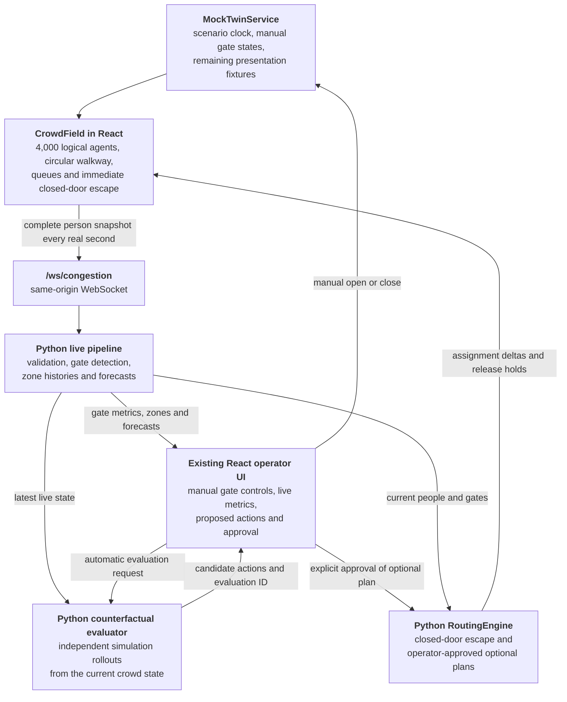

# North Star

**Spot the jam at Gate B before the crowd feels it, and send people somewhere better.**

The match ends. 4,000 people stand up at once and head for eight exits. One gate closes, another starts backing up, and an operator has a few seconds to decide what to do.

North Star is a human-in-the-loop stadium crowd-management prototype built around that moment. It simulates exactly 4,000 people leaving a fictional stadium through eight controllable boundary exits, streams every person's state to Python, detects persistent gate congestion, and suggests responses. People automatically bypass a closed gate via the nearest open door along the outer concourse; optional congestion-management plans require operator approval. Only the operator opens or closes gates.

> [!WARNING]
> The project is intentionally a decision-support demonstrator. It is not certified evacuation software and must not be presented as guaranteed public-safety guidance.

## 📍 At a glance

| | |
| --- | --- |
| **Population** | Exactly 4,000 stable logical person identities per simulation run |
| **Exits** | Eight controllable boundary gates, Gate A through Gate H; distinct from section access passages |
| **Seating** | Twenty-four seating sections |
| **Telemetry** | Complete per-person snapshot from React to FastAPI once per real second |
| **Detection** | Python-owned gate density, queue, speed, throughput, persistence, and clearing |
| **Rerouting** | Automatic nearest-open escape from closed doors; optional Python congestion plans require approval |
| **Forecasts and interventions** | Live Python zone forecasts and counterfactual rollouts; some presentation panels retain scripted fallbacks |
| **Status** | Integrated simulation-to-decision prototype; not calibrated or certified for real evacuation decisions |

## Contents

- [📍 At a glance](#-at-a-glance)
- [🧱 Current status](#-current-status)
- [🧭 System architecture](#-system-architecture)
- [👥 Stadium and person model](#-stadium-and-person-model)
- [🚦 Congestion detection](#-congestion-detection)
- [🔀 Current rerouting logic](#-current-rerouting-logic)
- [📡 Telemetry contract](#-telemetry-contract)
- [💻 Application modes](#-application-modes)
- [📁 Repository layout](#-repository-layout)
- [🚀 Getting started](#-getting-started)
- [🎬 Running the demo](#-running-the-demo)
- [🔌 Backend interfaces](#-backend-interfaces)
- [📈 Deterministic forecast baseline](#-deterministic-forecast-baseline)
- [🧪 Tests and quality checks](#-tests-and-quality-checks)
- [🐳 Docker](#-docker)
- [📌 Immediate roadmap](#-immediate-roadmap)
- [🔒 Safety and privacy](#-safety-and-privacy)

## 🧱 Current status

The person movement, gate detection, Python forecasts, counterfactual evaluation, and operator approval loop are connected. Some narrative/visual forecast panels remain scripted; this is not a calibrated real-world evacuation model.

| Area | State | Where |
| --- | --- | --- |
| 4,000-person movement, gate queues, operator gate control | ✅ Implemented and connected | React `CrowdField` |
| Live per-gate congestion detection | ✅ Implemented and connected | FastAPI `CongestionDetector` over `/ws/congestion` |
| Closed-door escape and outer-concourse circulation | ✅ Implemented locally and in Python | React `CrowdField`, Python `StadiumTwin` and `RoutingEngine` |
| Live 5- and 10-minute mass-balance forecasts | ✅ Connected to per-person zone histories | `backend/app/live/forecast.py`, `backend/app/forecasting/baseline.py` |
| Counterfactual evaluation and explicit approval | ✅ Connected; exact evaluation ID required | `backend/app/response/rollouts.py`, live registry and `LiveResponsePanel` |
| Synthetic zone-level simulation | 🟡 Separate legacy REST/WebSocket demo | `backend/app/simulation/` |
| Scenario clock and remaining presentation fixtures | ⚪ Scripted; not the live decision engine | `MockTwinService`, `MockScenarioEngine` |
| Legacy Python `ResponseService` | ⚪ Formula-based placeholder, separate from live rollouts | `backend/app/response/` |
| Validated dataset, trained forecasting model, calibration | ⏳ Pending | See below and the roadmap |

### Implemented and connected

- Existing 3D React stadium design rendered with React Three Fiber and Three.js.
- Exactly 4,000 stable logical person identities per simulation run.
- Twenty-four seating sections and eight exits, Gate A through Gate H.
- Explicit movement through seat row, section aisle, lower base path, access passage, outer circular concourse, boundary-gate queue, doorway, and exterior path.
- Capacity-limited queues at every gate.
- Individual operator control to open or close any gate.
- Permanent removal after a person exits; an exited ID cannot reappear during the run.
- Complete per-person telemetry sent from React to FastAPI once per real second.
- Backend validation of population accounting, unique IDs, run IDs, and increasing sequence numbers.
- Python-owned gate density, queue, speed, throughput, persistence, and clearing calculations.
- Live congestion presentation in the existing incident strip, risk summary, gate list, header, and 3D gate treatment.
- Automatic WebSocket reconnect and an explicit detector-unavailable state.
- Automatic Python evaluations with suggested actions; optional congestion plans and release holds require operator approval.
- Closing a gate immediately disperses affected pedestrians toward the nearest open boundary gate, even if Python is unavailable.
- Closed-gate escape and approved diversions use the continuous outer walking lane, never return through the seating bowl, and never teleport.
- Closed boundary gates block everyone still inside, including people already released from the queue. People already outside may finish walking away.
- Shared stadium geometry consumed by both TypeScript and Python.
- Unit, API, browser, build, lint, and Docker Compose checks.

### Live evaluation and legacy demo

- The live registry aggregates per-person telemetry into 12 zone histories and returns 24 forecasts: 5- and 10-minute horizons for each zone.
- The risk summary consumes live forecasts when available. The timeline uses live history and forecasts once it has at least two observations.
- The counterfactual evaluator restores independent Python twins from the current crowd state and compares candidate plans.
- The separate legacy REST demo uses synthetic zone-level snapshots; it is not the default stadium's operator-control loop.

### Still mocked or formula-driven

The default 3D page uses `MockTwinService` and `MockScenarioEngine` for:

- scenario clock and scripted stage progression;
- metro-delay narrative timing (gate changes are manual);
- fallback risk and forecast values before live data is available, plus remaining narrative/3D zone overlays;
- the standalone estimated-clearance metric and confidence presentation;
- contributing-factor percentages;
- historical presentation-stage and stabilization narratives.

The legacy Python `ResponseService` remains formula-based. The stadium's live intervention panel instead uses `CounterfactualEvaluator`, not this placeholder.

### Pending

- Generate the first reproducible multi-run stadium dataset.
- Train gradient-boosted forecasting models only after the dataset exists.
- Add measured before/after evaluation for queue, density, clearance time, walking distance, and rerouting.
- Calibrate capacities and thresholds against documented assumptions.
- Defer the wildfire scenario until the stadium loop is complete.

See [PROJECT_CONTEXT.md](PROJECT_CONTEXT.md) for the canonical architecture, ordered TODO, ownership, and acceptance criteria.

## 🧭 System architecture

The default application at `/` follows the integrated paths below. Closed-door escape is enforced locally without waiting for the backend. Optional congestion plans cross an explicit operator-approval boundary.



The live intervention loop is:

```text
React movement telemetry
    -> Python detection
    -> Python route-cost evaluation
    -> isolated candidate rollouts and proposed actions
    -> explicit operator approval of one evaluated candidate
    -> changed person-to-boundary-gate assignments
    -> React executes and visualizes assignments
```

No ML model is required for gate reassignment. The routing cost can remain deterministic and explainable. ML is reserved for future congestion forecasting after a suitable simulation dataset exists.

## 👥 Stadium and person model

The shared configuration is [shared/stadium-config.json](shared/stadium-config.json). It defines:

- population and coordinate scale;
- stadium bowl and circulation-ring geometry;
- Gate A to H identifiers, labels, and angles;
- default gate capacity;
- gate-approach geometry used by the Python detector.

The current prototype capacity is 30 people per simulated minute at each open gate. This is configurable demonstration data, not a measured stadium capacity.

Each person moves through these states:

```text
waiting in seat
    -> moving along row
    -> descending section aisle
    -> moving around lower base path
    -> nearest section access passage (independent of assigned exit)
    -> outer concourse (clockwise/counterclockwise shortest arc)
    -> waiting in assigned boundary-gate FIFO queue
    -> approaching the actual doorway (stops if gate closes)
    -> outside walk (only after crossing an open boundary gate)
    -> exited and removed
```

Movement is a deterministic waypoint model. It does not currently implement physical person-to-person collision forces. This keeps the first milestone reproducible and makes queue and route behavior easier to test.

Section passages and boundary gates are distinct. The controls and evaluation refer to boundary gates A–H, not the section openings. The continuous, visibly marked circulation lane is at ring scale 1.12, queue holding areas at 1.20–1.28, and the doorway at 1.331. All queue positions are **inside** the stadium boundary. A diverted person walks back only to the outer lane, then follows the circle to an open gate. The stadium design is retained.

## 🚦 Congestion detection

The backend constructs all eight approach polygons from the shared stadium configuration. For every telemetry batch it calculates:

- number of people inside the gate approach;
- approach density in people per square metre;
- queue length for people assigned to that gate with explicit queued telemetry (legacy phase-less inputs use the speed threshold);
- mean walking speed;
- boundary crossings observed during the trailing simulated minute (outside pedestrians are not counted again when they disappear);
- raw risk level;
- persistent congestion and clearing state.

Current prototype defaults:

| Signal | Elevated | High | Critical |
| --- | --- | --- | --- |
| Approach density | 2.2 people/m² | 3.2 people/m² | 4.5 people/m² |
| Queue length | 40 people | 80 people | 160 people |

| Setting | Value |
| --- | --- |
| Queue-speed threshold | 0.6 m/s |
| Critical-speed threshold | 0.35 m/s |
| Congestion persistence | 5 simulated seconds |
| Clear persistence | 10 simulated seconds |

> [!IMPORTANT]
> These thresholds are engineering defaults for the prototype. They are not certified crowd-safety limits.

Throughput is a trailing-minute measure, so it can remain nonzero briefly after closing a gate due to crossings that happened **before** closure. It does not mean new people are passing through. The deterministic walking speed is slowed for demonstration and still needs calibration against detector speed thresholds.

## 🔀 Current rerouting logic

A closed boundary gate immediately triggers a nearest-open-door search for every affected person still inside. Queue and pre-door pedestrians leave their old queue, return to the outer lane, and follow the shortest angular arc clockwise or counterclockwise. People still leaving the seating bowl keep their access passage and join the outer ring before diverting. Equal-distance choices use a stable person-ID tie break to disperse the crowd. Reopening the original gate does not make people reverse direction.

If all gates are closed, nobody can cross the boundary. Opening any gate reactivates the nearest-open search without needing a recommendation, approval, or backend connection. People already outside keep walking away. Congestion at an **open** gate does not trigger an unapproved optimization plan.

If an approved plan's destination closes, its redirect is suspended until another explicit approval. Reopening that gate cannot silently pull pedestrians back from their automatic detour. Existing approved release holds retain their deadline unless the operator stops the plan.

Automatic closed-door escape uses circular distance only, not queue forecasts. For the separate offline autonomous comparison policy, closed gates are excluded and remaining gates are scored using:

```text
walking-distance cost
  + switching and return-to-concourse cost
  + queue-length penalty
  + approach-density penalty
  + confirmed-congestion penalty
  + deterministic tie breaker
```

Live Python routing emits `gate_closed` escapes and approved `operator_plan` assignments. The browser also enforces closed-door escape locally, so it never waits for a network response to leave an unusable exit. The autonomous cost-based congestion policy remains available only for offline comparison runs. Frontend and Python rollouts share the same nearest-open rule.

The UI evaluates automatically while the run changes. Selecting a candidate pins its exact evaluation; background refresh cannot silently replace the selected actions. Approval sends its `evaluation_id`, and gate changes invalidate previous proposals. Results expire after 120 wall-clock seconds. “Keep current routes” stops an existing plan/holds without reversing completed movement or changing any gate.

## 📡 Telemetry contract

The frontend sends `message_type: "telemetry"` over `/ws/congestion` once per real second.

Every batch contains:

| Field | Meaning and validation |
| --- | --- |
| `run_id` | Stable for one simulation epoch |
| `sequence` | Strictly increasing within the run |
| `simulation_time_seconds` | Simulated, not wall-clock, time |
| `population` | Must equal 4,000 |
| `agents` | Every currently active identity |
| `exited_agents` | Every identity already removed from the run |
| `closed_gates` | Operator-controlled boundary gates that cannot be crossed |

An active person contains:

```json
{
  "person_id": 1842,
  "x": 12.4,
  "z": 5.4,
  "speed_mps": 0.3,
  "target_gate": "gate_b",
  "movement_state": "queued",
  "phase": "queue"
}
```

An exited person contains:

```json
{
  "person_id": 1842,
  "target_gate": "gate_b",
  "exited_at_seconds": 327.4
}
```

The backend returns one congestion record for each of the eight gates, live zones and forecasts, and routing deltas/holds. Routing also reports the active plan and `redirect_suspended`, so reopening a door cannot silently revive an obsolete redirect. Protocol validation errors are returned as structured WebSocket error messages without terminating the connection.

## 💻 Application modes

| Mode | URL | What it shows |
| --- | --- | --- |
| **Default 3D stadium** | `http://localhost:5173/` | The main experience. It contains the 4,000-person frontend simulation and the live `/ws/congestion` integration. |
| **Legacy REST dashboard** | `http://localhost:5173/?mode=live` | The separate Python `CrowdSimulation` zone model through REST. |

> [!NOTE]
> Despite the historical query name, `?mode=live` is not the live 3D person stream. It is useful for exercising the baseline forecast and response API contracts, but it should not be used to claim end-to-end 3D forecast integration.

## 📁 Repository layout

```text
North Star/
├── backend/
│   ├── app/
│   │   ├── congestion/       # Live per-person detector
│   │   ├── forecasting/      # Deterministic mass-balance baseline
│   │   ├── live/             # Run registry, zone histories and forecasts
│   │   ├── response/         # Live counterfactuals plus legacy response service
│   │   ├── routing/          # Closed-door escape and approved routing plans
│   │   ├── simulation/       # Separate synthetic zone simulation
│   │   ├── twin/             # Python stadium movement and rollout restoration
│   │   └── shared/           # REST API models
│   ├── scripts/              # Baseline command-line runner
│   └── tests/
├── frontend/
│   ├── e2e/                  # Playwright browser tests
│   └── src/
│       ├── components/       # Legacy REST dashboard
│       └── twin/
│           ├── congestion/   # WebSocket client and contracts
│           ├── live/         # Evaluation and approval API contracts
│           ├── mock/         # Clock and remaining presentation fixtures
│           ├── scene/        # React Three Fiber stadium
│           ├── services/     # Twin service boundary
│           ├── sim/          # 4,000-person movement model
│           ├── state/        # Zustand application state
│           └── ui/           # Existing operator interface
├── shared/
│   └── stadium-config.json   # React/Python geometry source of truth
├── PROJECT_CONTEXT.md        # Canonical status and ordered backlog
├── PROJECT_BRIEF.md          # Target product definition
├── TEAM_TASK_DISTRIBUTION.md # Four-person ownership
└── docker-compose.yml
```

## 🚀 Getting started

There are two ways to run North Star: local development with two terminals, or the full stack in [Docker](#-docker).

### Prerequisites

| Workflow | Requirements |
| --- | --- |
| Local development | Python 3.11 or newer; Node.js 22 or a current compatible LTS release; npm; a browser with WebGL support |
| Docker | Docker Engine and Docker Compose v2.20+ (or Docker Desktop). No host Python or Node installation is required. |

### 1. Start the Python backend

From the repository root:

```bash
cd backend
python3 -m venv .venv
source .venv/bin/activate
python -m pip install --upgrade pip
python -m pip install -e ".[dev]"
uvicorn app.main:app --reload --host 127.0.0.1 --port 8000
```

Verify the backend:

```text
http://localhost:8000/health
http://localhost:8000/docs
```

### 2. Start the React frontend

In a second terminal:

```bash
cd frontend
npm ci
npm run dev
```

Open `http://localhost:5173/`.

### 3. Optional: custom endpoints

The browser uses same-origin `/api` and `/ws` URLs. Vite forwards these to `http://127.0.0.1:8000`, so no environment file is needed. For custom endpoints:

```bash
cd frontend
cp .env.example .env
```

Supported frontend variables:

| Variable | Purpose |
| --- | --- |
| `API_PROXY_TARGET` | Backend destination for the Vite development proxy (server-side only) |
| `VITE_API_URL` | Optional external API base URL for both application modes |
| `VITE_CONGESTION_WS_URL` | Optional external congestion WebSocket URL |

Leave the `VITE_*` values blank for same-origin requests. The WebSocket automatically uses `wss://` when the page uses HTTPS. Remove old `localhost:8000` overrides from an existing `frontend/.env` when using the proxy defaults.

> [!CAUTION]
> `VITE_*` values are public build-time settings, never secrets. Never commit `.env` files containing local or secret values. The repository tracks only `.env.example`.

## 🎬 Running the demo

1. Start the backend and frontend.
2. Confirm the header shows `Detector live`.
3. Press `Start` and select a playback speed.
4. Observe people leave their rows through the visible aisle gaps.
5. Close Gate B or another gate from the gate list.
6. Observe the queue disperse automatically onto the marked circular walkway toward the nearest open exit; nobody crosses the closed boundary. People already outside keep walking away.
7. Wait for the Python detector to confirm congestion at any overloaded approach.
8. Inspect the live gate density, queue, mean speed, throughput, incident strip, and 3D gate highlight.
9. Optionally select a congestion-management proposal and press **Approve**. Closed-gate escape does not need this action.
10. Reopen a gate or reset the run. Gate states never change as a side effect of a recommendation.

> [!NOTE]
> The intervention panel uses actual Python counterfactual results. Live forecasts feed the risk summary and timeline when available. These are simulation estimates, not measured real-world safety outcomes; some narrative and fallback visuals remain presentation fixtures.

## 🔌 Backend interfaces

<details>
<summary><b>Health and legacy REST demo</b> (10 endpoints)</summary>

| Method | Path |
| --- | --- |
| `GET` | `/health` |
| `GET` | `/api/state` |
| `POST` | `/api/simulation/start` |
| `POST` | `/api/simulation/step` |
| `POST` | `/api/simulation/pause` |
| `POST` | `/api/simulation/reset` |
| `POST` | `/api/incidents/{incident}` |
| `GET` | `/api/forecasts` |
| `GET` | `/api/interventions` |
| `POST` | `/api/interventions/{intervention_id}/approve` |

</details>

Live stadium run endpoints:

| Method | Path | Role |
| --- | --- | --- |
| `GET` | `/api/runs` | List in-memory runs |
| `POST` | `/api/runs/{run_id}/interventions/evaluate` | Evaluate isolated candidate rollouts |
| `POST` | `/api/runs/{run_id}/interventions/{intervention_id}/approve` | Approve the exact reviewed result with body `{"evaluation_id":"…"}` |
| `DELETE` | `/api/runs/{run_id}/plan` | Clear the optional plan and release holds |
| `GET` | `/api/runs/{run_id}/export` | Export run history, assignments and plan state |

WebSockets:

| Path | Role |
| --- | --- |
| `/ws/congestion` | Active 3D per-person input; gate detection, zones, forecasts and routing output |
| `/ws/telemetry` | Legacy synthetic zone-snapshot output |

## 📈 Deterministic forecast baseline

The backend baseline extends the current zone mass balance:

```text
net flow = inflow per minute - outflow per minute
future people = max(0, current people + net flow × horizon)
future density = future people / zone area
```

Run its command-line example:

```bash
cd backend
source .venv/bin/activate
python -m scripts.run_baseline --gate-b-closed --metro-delayed --steps 8
```

This algorithm is implemented, tested, and connected to the default 3D person's telemetry through `ZoneAggregator` and `LiveForecaster`. The live pipeline emits 5- and 10-minute forecasts for each zone. If a compatible trained GBM artifact is installed, the forecaster can use it; otherwise it uses the deterministic baseline. No training is required to run the current application. Forecast values and confidence bands remain prototype estimates that require validation.

## 🧪 Tests and quality checks

Run backend tests and linting:

```bash
cd backend
source .venv/bin/activate
ruff check app tests
pytest -q
```

Run frontend unit tests and the production build:

```bash
cd frontend
npm test -- --run
npm run build
```

Run browser tests:

```bash
cd frontend
npx playwright install chromium
npm run test:e2e -- --reporter=list
```

Validate repository and Docker configuration:

```bash
git diff --check
docker compose config --quiet
```

At the time of this README update, the suite contains:

| Suite | Count |
| --- | --- |
| Backend test cases | 84 |
| Frontend unit tests | 64 |
| Playwright browser tests | 6 defined: four UI/contract tests and two opt-in real-stack tests |
| Docker smoke test | Covers HTTP, WebSockets, congestion, nearest-open escape and the approval boundary |

The counts describe the checked-in suites, not a claim that every browser test was rerun for this revision. To run all six browser tests against an already running full stack, use `PLAYWRIGHT_BASE_URL=http://localhost:8080 npm run test:e2e -- --workers=1 --reporter=list` from `frontend/`. The physical boundary-gate test takes about two minutes.

> [!NOTE]
> The frontend production build currently emits a non-blocking large-chunk warning for the 3D bundles.

## 🐳 Docker

Start Docker Desktop (or Docker Engine), then run from the repository root:

```bash
docker compose up --build --wait
```

Open **http://localhost:8080**. This serves the existing stadium UI, REST API, and WebSockets through one origin. The backend is private to the Compose network, not exposed on host port 8000.

| Check | URL |
| --- | --- |
| API documentation | `http://localhost:8080/docs` |
| Frontend health | `http://localhost:8080/health` |
| Backend health through the proxy | `http://localhost:8080/api/health` |

Check the complete connection, including real 4,000-person telemetry and gate rerouting:

```bash
docker compose run --rm smoke
```

The smoke test creates an isolated synthetic run. It does not train a model, run intervention rollouts, or reset another simulation.

**Runtime and security.** Both application containers run as non-root users with read-only runtime filesystems, limited writable paths, health checks, and rotated logs. The frontend waits for backend readiness. Datasets and models persist in the `backend-data` named volume.

> [!IMPORTANT]
> Active simulation sessions remain in memory and reset when the backend restarts, so keep exactly one backend process and replica.

For source hot reload, use the development override:

```bash
docker compose -f docker-compose.yml -f docker-compose.dev.yml up --build --wait
```

> [!TIP]
> The development override also uses port 8080. Stop the normal stack first, or set `FRONTEND_PORT=8081` for a second stack. Development uses a separate Compose project and data volume.

See [the Docker runbook](docs/DOCKER.md) for configuration, containerized tests, data/model management, troubleshooting, shutdown, and deployment limitations. The Docker setup does not change the stadium design.

## 📌 Immediate roadmap

Work should proceed in this order:

1. Calibrate walking speeds, gate capacity, queue layout, and thresholds; consider pedestrian collision avoidance.
2. Export reproducible comparison runs for all-open gates, automatic closed-door escape, and approved congestion diversions.
3. Replace remaining scripted narrative panels with live measurements.
4. Build leakage-safe gradient-boosted forecasting only after the dataset is validated.
5. Rehearse the stadium demonstration before starting wildfire work.

Detailed ownership and completion conditions are maintained in:

- [PROJECT_CONTEXT.md](PROJECT_CONTEXT.md)
- [PROJECT_BRIEF.md](PROJECT_BRIEF.md)
- [TEAM_TASK_DISTRIBUTION.md](TEAM_TASK_DISTRIBUTION.md)
- [PERSON_1_TO_PERSON_2_DATA_HANDOFF.md](PERSON_1_TO_PERSON_2_DATA_HANDOFF.md)
- [PERSON_2_ALGORITHM_IMPLEMENTATION.md](PERSON_2_ALGORITHM_IMPLEMENTATION.md)

## 🔒 Safety and privacy

- The prototype uses synthetic people and anonymous numerical IDs.
- No facial recognition or personally identifiable information is required.
- Detection thresholds and gate capacities are configurable demonstration assumptions.
- Operator review remains mandatory for optional congestion plans; automatic nearest-open escape is a simulation rule, not validated real-world emergency guidance.
- North Star must not claim certification, deployment readiness, or guaranteed safety.
